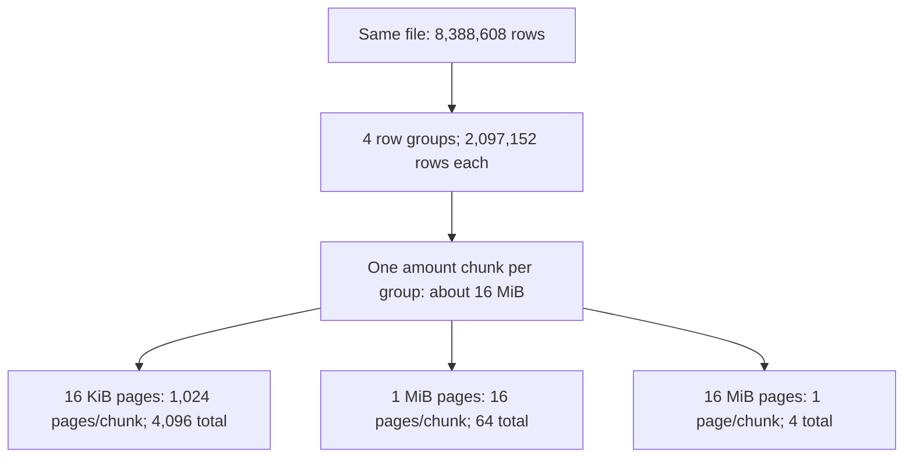
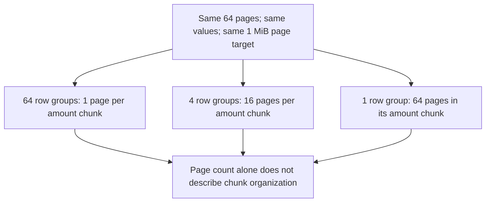
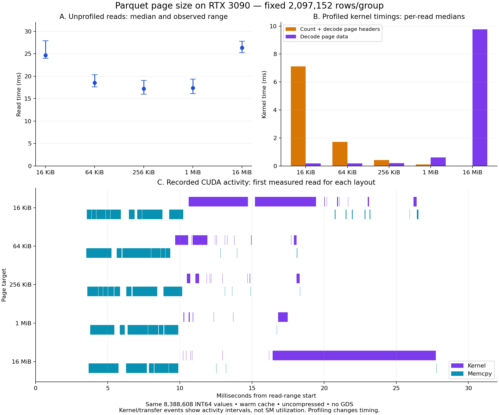
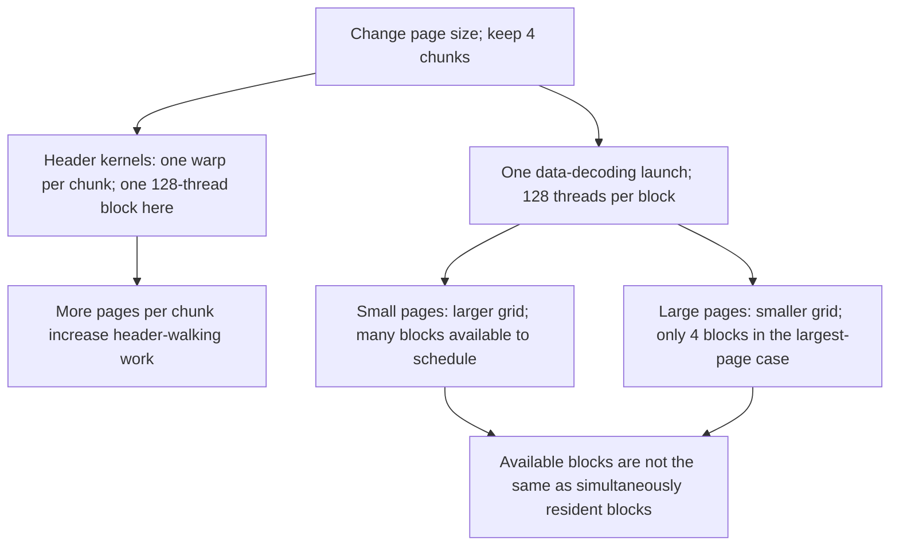
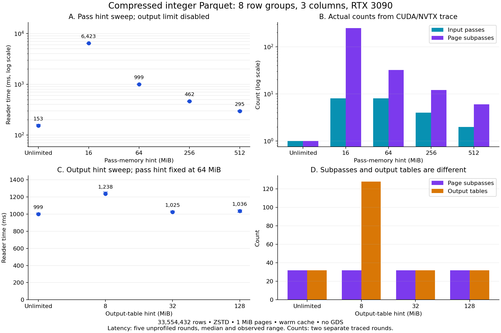
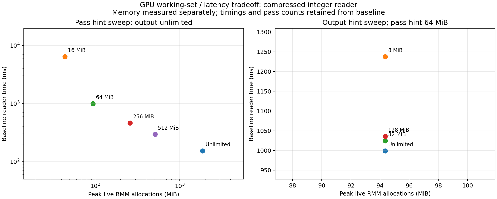

# Parquet layout on an RTX 3090: row groups, pages and GPU traces

We varied Parquet layout while keeping the values and GPU aggregation fixed.
Middle-sized pages read faster than either extreme. With 1 MiB pages, changing
row-group size had a much smaller effect. CUDA traces help explain the page-size
result: many tiny pages increased header-processing time, whereas a few large
pages produced a small decoding grid and a longer data-decoding kernel.

The page-size changes **did not increase the number of kernel launches or make
kernels run concurrently** in the captured reads. They changed the number of
blocks in the data-decoding launch and how long different kernels ran.

## What we measured

- NVIDIA GeForce RTX 3090, 24 GiB; driver 610.88; Ubuntu 20.04 under WSL2.
- Bazel-built C++ reader using libcudf 26.10 and the locked LLVM/SDK dependencies.
- One INT64 `amount` column: 8,388,608 non-null values, generated with seed 42.
- Same values and order in every layout; expected sum **41,933,446,337**.
- PLAIN encoding, no dictionary, no compression, no statistics; approximately
  64 MiB of decoded values per file.
- Files on WSL's Linux filesystem under `/tmp`; warm-cache reads; no cache eviction.
- Compatibility I/O explicitly enabled; **no GPUDirect Storage**.
- One unmeasured warm-up per file, then reproducibly shuffled file order per round.

Host wall-clock read timing includes metadata, allocation, file access, transfer,
and GPU decoding. It ends with GPU synchronization. The GPU sum and scalar copy
are timed separately; table destruction is outside both intervals. Every measured
sum is checked against the CPU reference. See [reproduction instructions](README.md).

This is a controlled single-column layout experiment, not a reproduction of the
paper's full TPC-H/A100/PystachIO/GDS configuration.

## Layout and execution are different levels

A row group contains one chunk per selected column. Each chunk holds page headers
and encoded page payloads. Our selected column therefore has four chunks when
there are 2,097,152 rows per row group.



These sizes are writer targets. We inspect actual data-page counts from Parquet
encoding statistics rather than infer them from the requested size.

The simplified reader path is:

```mermaid
flowchart LR
    A["CPU: read footer and choose chunks"] --> B["Read encoded chunk bytes into GPU buffers"]
    B --> C["GPU: count page headers"]
    C --> D["Host: allocate page descriptors through RMM"]
    D --> E["GPU: decode page headers"]
    E --> F["Host: allocate output-column buffers"]
    F --> G["GPU: decode page values"]
    G --> H["GPU sum; copy resulting scalar to CPU"]
```



This diagram omits helper kernels, preprocessing, and compressed/nested/string
paths. Descriptors are metadata about pages, not separate copies of their payloads.
For our uncompressed fixed-width data, decoding writes into output-column buffers.

## Experiment 1: vary page size, keep row groups fixed

The initial sweep used nine measured rounds. We reran its page-only portion with
**15 unprofiled rounds per layout**, retaining four row groups. Every one of the
75 measured sums matched the reference.

| Page target | Actual total pages | Median read | Observed min–max |
|---|---:|---:|---:|
| 16 KiB | 4,096 | 24.681 ms | 23.988–27.926 ms |
| 64 KiB | 1,024 | 18.541 ms | 17.627–20.346 ms |
| 256 KiB | 256 | 17.231 ms | 15.995–19.096 ms |
| 1 MiB | 64 | 17.412 ms | 16.098–19.383 ms |
| 16 MiB | 4 | 26.378 ms | 25.264–27.823 ms |

The middle settings performed similarly; their ranges overlap. The extremes
were slower. These descriptive measurements do not establish a universal optimal
page size. [Unprofiled report](results-pages/report.md) · [raw samples](results-pages/samples.csv).

## Experiment 2: fix 1 MiB pages, vary row-group size

We ran **15 measured rounds per layout**, with all 105 sums correct.

| Rows/group | Row groups | Pages per chunk | Total pages | Median read |
|---:|---:|---:|---:|---:|
| 131,072 | 64 | 1 | 64 | 16.840 ms |
| 262,144 | 32 | 2 | 64 | 16.653 ms |
| 524,288 | 16 | 4 | 64 | 16.602 ms |
| 1,048,576 | 8 | 8 | 64 | 17.295 ms |
| 2,097,152 | 4 | 16 | 64 | 16.832 ms |
| 4,194,304 | 2 | 32 | 64 | 17.333 ms |
| 8,388,608 | 1 | 64 | 64 | 17.703 ms |

Observed timing ranges overlap: there is no clear best row-group size in this run.
The useful control is **64 pages total in every file**. Changing row groups
redistributes those pages among chunks.



One page per chunk can still provide many pages across the complete read.
[Full report](results-1mib/report.md) · [raw samples](results-1mib/samples.csv).
The earlier [64 KiB-page row-group sweep](results/report.md) is also preserved.

## Experiment 3: trace the page sweep

We installed checksum-pinned **Nsight Systems 2026.3.2.476** locally and collected
software CUDA/CUPTI and NVTX events. Capture starts after warm-up, inside the
C++ driver's `measured` range. Nested `benchmark/read` and `benchmark/sum` ranges
separate the operations. CPU sampling and hardware counters are not enabled.

Five traced rounds per layout produced **25 correct sums, 875 kernel events and
1,425 memcpy events**. Those event totals include both reads and sums; the table
below summarizes only the read ranges. Profiled timings are separate from the
unprofiled performance measurements above.

| Page target | Data-decoder grid | Header kernels | Value decoder | Kernel busy time | Memcpy busy time |
|---|---:|---:|---:|---:|---:|
| 16 KiB | 4,096 blocks | 7.119 ms | 0.189 ms | 7.513 ms | 5.807 ms |
| 64 KiB | 1,024 blocks | 1.721 ms | 0.178 ms | 2.017 ms | 5.461 ms |
| 256 KiB | 256 blocks | 0.419 ms | 0.202 ms | 0.716 ms | 5.504 ms |
| 1 MiB | 64 blocks | 0.113 ms | 0.611 ms | 0.800 ms | 5.495 ms |
| 16 MiB | 4 blocks | 0.012 ms | 9.775 ms | 9.862 ms | 5.519 ms |

All times are per-layout medians. Header time combines the page-counting and
page-header-decoding kernels. Kernel and memcpy busy times are unions of their
recorded intervals; independently calculated medians need not add up.



### What changed in the launches?

Every captured read launched **33 kernels**, including **one** page-data decoding
kernel. The data decoder used **128 threads per block**. Its grid scaled with
page count: 4,096, 1,024, 256, 64, or 4 blocks. Maximum observed overlapping
kernel execution was **one** for every layout. Multiple stream IDs appeared,
but the recorded kernel intervals did not overlap.



The source's launch mappings agree with the recorded grids. The header kernels
have one warp per chunk; our four chunks fit in one block. Their time rises with
page count. The largest-page case supplies only four data-decoding blocks and
spends much longer in that kernel. This supports the tradeoff explanation, but
is not a measurement of SM occupancy or proof of a particular hardware bottleneck.

### What does “utilization” mean here?

Our **traced activity fraction** is the union time of recorded kernel or memcpy
events divided by the synchronized read-range duration. It is **not** SM
utilization, occupancy, memory-bandwidth utilization, or an SM hardware counter.
CUDA memsets are not included in that definition.

Activity fractions ranged from approximately 33% to 58%; higher fractions did
not imply faster reads. A longer-running kernel can increase activity fraction
while making the query slower. Gaps with no recorded kernel or memcpy were
roughly 11.5–13.0 ms per read. We cannot attribute all of those gaps from this
trace alone: CPU work, file access, allocation, synchronization, other GPU activity
not included in our definition, and tool overhead may contribute.

Hardware counters were deferred. A local capability probe reported insufficient
privilege, while CUDA kernel and memcpy tracing worked.

## Files to explore

- [Profiler installation and reproduction commands](README.md#cuda-tracing-with-nsight-systems).
- [cuDF source guide and allocation walkthrough](SOURCE_GUIDE.md).
- [Trace report](results-pages-traced/report.md), [summary](results-pages-traced/summary.csv),
  [per-read phases](results-pages-traced/read-phases.csv), [kernels](results-pages-traced/kernels.csv),
  and [CUDA runtime APIs](results-pages-traced/cuda-apis.csv).
- [SVG figure](results-pages-traced/tracing.svg) for export.
- Full interactive trace: `traces/pages.nsys-rep`; SQLite export: `traces/pages.sqlite`.
  Lossless `.gz` archives of these four baseline capture files are checked into Git; new capture names are ignored by default.

The code, controls, raw measurements and traces are preserved so we can test
additional explanations rather than infer hardware utilization from elapsed time.

## Follow-up: compressed integers with multiple row groups

> **Takeaway: for this workload, an overly small pass-memory hint sharply increased reader time; output-table size is a separate tuning control.**
>
> Both the 16 MiB and 64 MiB pass hints used eight input passes. Increasing the
> hint reduced subpasses from **248 to 32** and median reader time from
> **6.42 s to 1.00 s**—about **6.4× faster**. Separately, an 8 MiB output hint
> increased returned tables from 32 to 128 while subpasses stayed at 32.
>
> **Memory follow-up:** the 16 MiB hint peaked at **44.05 MiB** of live RMM
> allocations versus **94.36 MiB** at 64 MiB: less than half the live working set,
> at about 6.4× the reader time. Both are soft hints, not total-memory caps.
> [Memory measurements and methodology](results-subpasses/memory-report.md).

We added a [trace-verified subpass experiment](SUBPASSES.md) with **eight row
groups, three flat integer columns, and ZSTD compression**. There are no strings,
dictionaries, null values or nested columns in this follow-up. The stored file
is 251.6 MiB; the numeric output values occupy 640 MiB before validity masks.

The main sweep holds the output limit disabled. Both the 16 MiB and 64 MiB
pass hints use eight input passes, but their trace-confirmed subpass counts are
248 and 32 respectively. Median reader time changes from **6,423.41 ms to
998.97 ms**. Unlimited input/output hints produce one pass, one subpass and
**153.10 ms** on this fixture.

A second sweep keeps the pass hint at 64 MiB. An 8 MiB output hint increases
returned tables from 32 to 128 while the input-pass and subpass counts remain
8 and 32. This separates output-table batching from page-subpass batching.

All **40 unprofiled and 16 profiled sums** matched. The driver times `has_next()`
as well as `read_chunk()`, because preparation and decompression can happen in
`has_next()`. Reduction time is reported separately. The separate memory run
below adds peak live-allocation measurements without changing these baseline timings.



See the [full follow-up notes and reproduction commands](SUBPASSES.md) and
[recorded report](results-subpasses/report.md).

## GPU memory follow-up: a measured working-set tradeoff

We ran **three separate memory rounds per configuration**, plus an excluded
warm-up, reusing the same fixture and integer-only reader. All **24 measured
reads** matched the expected rows, columns and sum; tracked live allocations
returned to zero after every reader was destroyed. Peaks were identical across
all three rounds for each configuration. The original timing and trace runs
remain the basis for latency and pass/subpass counts.

| Pass hint | Input passes / subpasses | Peak live RMM allocations | Baseline median read |
|---|---:|---:|---:|
| Unlimited | 1 / 1 | 1,861.60 MiB | 153.10 ms |
| 16 MiB | 8 / 248 | 44.05 MiB | 6,423.41 ms |
| 64 MiB | 8 / 32 | 94.36 MiB | 998.97 ms |
| 256 MiB | 4 / 12 | 259.16 MiB | 462.27 ms |
| 512 MiB | 2 / 6 | 510.77 MiB | 295.13 ms |

**The memory/performance tradeoff is visible:** at matched eight input passes,
the 16 MiB hint uses less than half the peak live allocation bytes of 64 MiB,
but requires far more subpasses and about 6.4× the reader time. Unlimited hints
are faster here while needing roughly 20× the peak live allocations of 64 MiB.
The 16 MiB hint still peaks above 44 MiB, demonstrating why it cannot be treated
as a hard capacity limit.

At a fixed 64 MiB pass hint, all four output hints peaked at **94.36 MiB**.
The 8 MiB output hint returned more tables and ran slower without reducing the
overall peak on this fixture. Smaller returned tables alone do not guarantee a
smaller reader working set. These results assume tables are consumed and released
one at a time; retaining them changes the memory requirements.

The RMM statistics adaptor wraps the current device resource, covering internal
reader temporaries as well as output and reduction allocations routed through
that resource. The default upstream CUDA allocator is preserved; no pool is added.
This is **peak live allocation accounting**, not a physical-residency measurement.
A separate thread samples device-wide `cudaMemGetInfo` usage with a requested
1 ms sleep. Median sampled increases above the per-read starting usage were
**1,866, 48, 98, 266 and 514 MiB**, respectively, for the table above. Device usage
already started around **1,303.5 MiB** before each read. Other GPU users,
context/library overhead and sampling gaps can affect those values; short peaks
can be missed. Neither metric proves physical residency under WSL.

For capacity planning, compare working-set peaks while leaving headroom for
untracked allocations, allocator reservation and concurrent workloads. Re-measure
with the actual allocator and output-retention policy rather than using the hint
as a memory guarantee.



[Full memory report](results-subpasses/memory-report.md) ·
[Raw memory samples](results-subpasses/memory-samples.csv) ·
[Joined memory/time/pass counts](results-subpasses/memory-summary.csv)

Reproduce after building the updated benchmark:

```bash
/tmp/cudf-layout-venv/bin/python experiments/memory_subpasses.py
```

The script preserves the original baseline and trace outputs. Use
`--analyze-only` to regenerate this follow-up's report and figure from saved
memory samples, without GPU work. [Setup and measurement details](README.md#gpu-memory-follow-up).

## 15 GiB refresh

The [large-scale follow-up](LARGE_SCALE.md) preserves the original results and
adds 15 GiB decoded datasets. The primary compressed sweep uses pass hints from
256 MiB through 8 GiB, rather than treating 16 MiB as a practical default.

A 2 GiB hint read the file in **3.690 s** with **2,044.34 MiB** peak live RMM
allocations; 8 GiB took **3.348 s** at **8,189.96 MiB**. The roughly 9% reader-time
improvement required about four times the peak allocation. Both input-pass and
subpass counts change, so their individual costs are not isolated.

The uncompressed Page sweep uses 60 Row Groups and a fixed 2 GiB pass hint.
16 MiB Pages had the lowest recorded median (**6.694 s**), with overlapping
observed ranges for 256 KiB and 1 MiB Pages. Tiny 16 KiB Pages took **9.792 s**.
Unlike the original whole-file experiment, the new reads use **30 input passes,
30 subpasses and 30 decoder launches**. The decoder grids range from 32,768 blocks
for tiny Pages to 32 for 16 MiB Pages. Reader kernel counts are 1,230 for the two
smallest Page targets and 1,020 for the others; no overlapping reader kernels were
observed. The one-block-per-Page mapping was checked by summing decoder grids
against actual Parquet Page counts.

All **56 primary measured reads** passed amount-sum, row-count and selected-column
checks. Two separate memory rounds per configuration returned to zero tracked
live bytes. The earlier small-hint diagnostic's 15 completed timing reads are
also preserved; its interrupted trace is not used. Read timings, memory peaks,
and traces come from separate runs. Page files exceed available host RAM, so
excluded warm-ups do not establish a warm filesystem cache.

- [Compressed timing and trace results](results-large-15gib/report.md)
- [Memory results](results-large-15gib/memory-report.md)
- [Page-size results and figure](results-large-pages-15gib/report.md)
