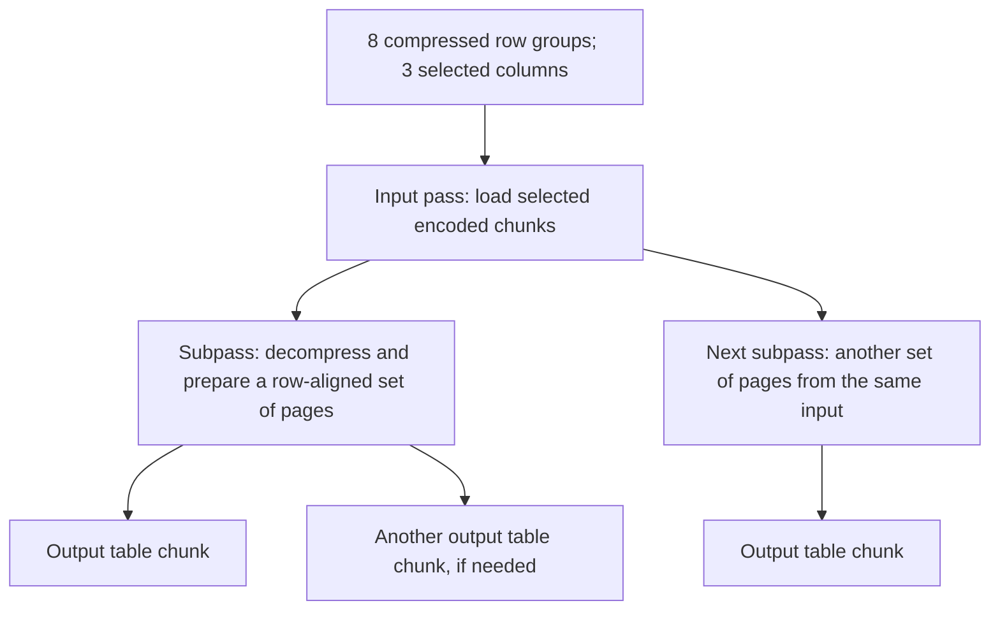

# Compressed Parquet: input passes, page subpasses and output chunks

This follow-up exercises the multi-subpass reader path with multiple row groups
and columns, rather than the original uncompressed single-column fixture.
[Recorded measurements](results-subpasses/report.md) include actual trace counts.

> **Takeaway: for this workload, an overly small pass-memory hint sharply increased reader time; output-table size is a separate tuning control.**
>
> Both the 16 MiB and 64 MiB pass hints used eight input passes. Increasing the
> hint reduced subpasses from **248 to 32** and median reader time from
> **6.42 s to 1.00 s**—about **6.4× faster**. Separately, an 8 MiB output hint
> increased returned tables from 32 to 128 while subpasses stayed at 32.
>
> **Memory follow-up:** the 16 MiB hint peaked at **44.05 MiB** of live RMM
> allocations versus **94.36 MiB** at 64 MiB: less than half the live working set,
> at about 6.4× the reader time. Both are soft hints, not total-memory caps.
> [Memory measurements and methodology](results-subpasses/memory-report.md).

## Workload

- 33,554,432 rows in eight row groups of 4,194,304 rows each.
- All three columns are selected: `amount` INT64, `customer_id` INT64, `quantity`
  INT32. All three are flat integer columns.
- No null values, strings, dictionaries, or nested columns.
- ZSTD level 3; 1 MiB target pages; row-group statistics enabled; no page indexes.
- Approximately 250 MiB on disk. Numeric values alone decode to 640 MiB;
  validity masks and temporary working buffers require additional storage.
- No predicates or GDS; warm Linux filesystem cache; same RTX 3090 and SDK.

The fixture is synthetic. Multiple row groups, integer widths and compression make this a broader reader
workload, but it does not represent every production distribution. Strings and
nested/list columns are deliberately excluded.

## Recorded findings

All **40 unprofiled and 16 profiled** sums matched **1,677,479,147,194**.
The pass-limit sweep below disables the output limit; its table count therefore
matches its observed subpass count on this fixture.

| Pass hint | Input passes | Subpasses | Median reader time |
|---|---:|---:|---:|
| Unlimited | 1 | 1 | 153.10 ms |
| 16 MiB | 8 | 248 | 6,423.41 ms |
| 64 MiB | 8 | 32 | 998.97 ms |
| 256 MiB | 4 | 12 | 462.27 ms |
| 512 MiB | 2 | 6 | 295.13 ms |

The **16 versus 64 MiB** comparison holds the number of input passes at eight.
The smaller hint causes many more subpasses and substantially more reader time.
This is consistent with repeated preparation, decompression and decode work per
batch; counts and timings alone do not isolate the cost of each operation.

The unlimited comparison changes both input-pass and subpass counts. It fits
comfortably on this GPU for this fixture, but the fastest setting here is not
necessarily suitable for datasets approaching GPU memory capacity. The memory
follow-up below quantifies the live-allocation tradeoff on this fixture.

With the pass hint fixed at **64 MiB**, all output-hint settings still had
**8 input passes and 32 subpasses**:

| Output hint | Returned tables | Median reader time | Median sum time |
|---|---:|---:|---:|
| Unlimited | 32 | 998.97 ms | 9.40 ms |
| 8 MiB | 128 | 1,237.66 ms | 36.97 ms |
| 32 MiB | 32 | 1,024.86 ms | 10.97 ms |
| 128 MiB | 32 | 1,035.57 ms | 9.70 ms |

The 8 MiB output hint increases returned-table count without increasing subpass
count. It also increases reader and reduction overhead in this synchronized driver.
A large output hint cannot combine separate subpasses into one table here.


The pass-sweep latency and count panels use logarithmic vertical scales; the
output-sweep panels use linear scales. Error bars show observed
min–max ranges from five baseline rounds, not confidence intervals. Count panels
come from two separate profiled rounds; the counts agreed between rounds.

[Full measurements](results-subpasses/report.md) ·
[baseline samples](results-subpasses/samples.csv) ·
[trace counts](results-subpasses/trace-counts.csv) ·
[SVG figure](results-subpasses/subpasses.svg)

## Two independent controls

The C++ driver explicitly calls the overload accepting both byte limits:

```cpp
cudf::io::chunked_parquet_reader reader(chunk_limit, pass_limit, options);
```

- **`pass_read_limit`:** a hint for encoded input and temporary decompression
  memory. It affects input-pass grouping and page-subpass selection.
- **`chunk_read_limit`:** a hint for the decoded table returned by each call.

Zero disables a limit. Neither is a hard cap on total GPU memory. A compressed
row group larger than the pass hint must still be loaded, and progress rules
can require more working memory than the requested hint.

The caller controls the explicit overload. The convenience overload may derive
a pass hint from the output limit; this benchmark avoids that coupling by always
passing both values. The source snapshot we studied derives 1.5× the output hint
in its convenience overload; do not assume that heuristic across versions.

## Experiment matrix

1. Hold output hint at **0 (unlimited)**; vary pass hint through **0, 16, 64, 256,
   and 512 MiB**.
2. Hold pass hint at **64 MiB**; vary output hint through **0, 8, 32,
   and 128 MiB**.

The shared 64/0 configuration leaves eight unique configurations. Each runs
one excluded warm-up, then five measured rounds in shuffled order. Two further
rounds per configuration are collected separately under Nsight Systems.



Changing the output-table limit is not evidence of changing subpass count.
The trace must distinguish the boundaries. Changing the pass hint may affect
both input passes and subpasses, so comparisons should check both counts.

## Timing and correctness

- **Read time** includes construction and every synchronized `has_next()` and
  `read_chunk()` call. `has_next()` performs preparation and can read/decompress
  data; timing only `read_chunk()` would miss substantial work.
- **Sum time** includes the GPU reduction and scalar transfer for each returned
  output table. The per-chunk sums are accumulated on the host.
- **Total time** additionally includes buffer/reader destruction and loop overhead.
- Every configuration must return all rows, three columns, and the same amount sum.
- Returned output tables are consumed and released one at a time.

More output chunks mean more reductions and scalar transfers in this driver.
The report separates those costs from synchronized reader time. Timings include
extra synchronization for measurement, so this is not an optimized overlapping
streaming pipeline.

## How we prove the path ran

The profile contains a `sample:pass_limit:chunk_limit:iteration` range per read.
Inside it we count:

- `preprocess_subpass_pages`: one range per actual subpass.
- `count_page_headers_kernel`: one launch per input pass for this fixture,
  which deliberately has no page indexes. This is an implementation-specific
  input-pass proxy, not a universal cuDF event contract.
- `read_chunk_internal`: one range per returned output table. Counts are checked
  against the driver's observed return counts.

The script fails if no sample has more subpasses than input passes, or if the
required trace evidence is missing. It also fails on any row-count or sum mismatch.
Hardware counters are not requested.

## Reproduce

Use the [existing helper environment and profiler setup](README.md#cuda-tracing-with-nsight-systems), then:

```bash
bazelisk build //:subpass_benchmark
/tmp/cudf-layout-venv/bin/python experiments/subpasses.py
```

This regenerates the fixture under `/tmp/cudf-subpass-data`, runs the baseline,
collects the trace, and writes `results-subpasses/`. To reuse that same fixture:

```bash
/tmp/cudf-layout-venv/bin/python experiments/subpasses.py --reuse-fixture
```

`--group-rows`, `--groups`, `--repeats`, `--trace-repeats`, `--data-dir`, `--output`
and `--nsys` configure the workload and tools. Keep enough rows per group for
its decompressed pages to require multiple subpasses at the smaller hints.

Small artifacts in `results-subpasses/` include fixture parameters, baseline and
profiled samples, trace counts and the report. Full baseline traces are preserved at
`traces/subpasses.nsys-rep` and `traces/subpasses.sqlite` with lossless `.gz` archives checked into Git for this baseline.

Source: [subpass selection](https://github.com/NVIDIA/cudf/blob/816f682244c080b438792eec6bc8eda6c3b0583a/cpp/src/io/parquet/reader_impl_chunking.cu#L208).

Regenerate the chart from the saved summaries, without GPU work:

```bash
/tmp/cudf-layout-venv/bin/python experiments/plot_subpasses.py
```

## GPU memory follow-up: a measured working-set tradeoff

We ran **three separate memory rounds per configuration**, plus an excluded
warm-up, reusing the same fixture and integer-only reader. All **24 measured
reads** matched the expected rows, columns and sum; tracked live allocations
returned to zero after every reader was destroyed. Peaks were identical across
all three rounds for each configuration. The original timing and trace runs
remain the basis for latency and pass/subpass counts.

| Pass hint | Input passes / subpasses | Peak live RMM allocations | Baseline median read |
|---|---:|---:|---:|
| Unlimited | 1 / 1 | 1,861.60 MiB | 153.10 ms |
| 16 MiB | 8 / 248 | 44.05 MiB | 6,423.41 ms |
| 64 MiB | 8 / 32 | 94.36 MiB | 998.97 ms |
| 256 MiB | 4 / 12 | 259.16 MiB | 462.27 ms |
| 512 MiB | 2 / 6 | 510.77 MiB | 295.13 ms |

**The memory/performance tradeoff is visible:** at matched eight input passes,
the 16 MiB hint uses less than half the peak live allocation bytes of 64 MiB,
but requires far more subpasses and about 6.4× the reader time. Unlimited hints
are faster here while needing roughly 20× the peak live allocations of 64 MiB.
The 16 MiB hint still peaks above 44 MiB, demonstrating why it cannot be treated
as a hard capacity limit.

At a fixed 64 MiB pass hint, all four output hints peaked at **94.36 MiB**.
The 8 MiB output hint returned more tables and ran slower without reducing the
overall peak on this fixture. Smaller returned tables alone do not guarantee a
smaller reader working set. These results assume tables are consumed and released
one at a time; retaining them changes the memory requirements.

The RMM statistics adaptor wraps the current device resource, covering internal
reader temporaries as well as output and reduction allocations routed through
that resource. The default upstream CUDA allocator is preserved; no pool is added.
This is **peak live allocation accounting**, not a physical-residency measurement.
A separate thread samples device-wide `cudaMemGetInfo` usage with a requested
1 ms sleep. Median sampled increases above the per-read starting usage were
**1,866, 48, 98, 266 and 514 MiB**, respectively, for the table above. Device usage
already started around **1,303.5 MiB** before each read. Other GPU users,
context/library overhead and sampling gaps can affect those values; short peaks
can be missed. Neither metric proves physical residency under WSL.

For capacity planning, compare working-set peaks while leaving headroom for
untracked allocations, allocator reservation and concurrent workloads. Re-measure
with the actual allocator and output-retention policy rather than using the hint
as a memory guarantee.


[Full memory report](results-subpasses/memory-report.md) ·
[Raw memory samples](results-subpasses/memory-samples.csv) ·
[Joined memory/time/pass counts](results-subpasses/memory-summary.csv)

Reproduce after building the updated benchmark:

```bash
/tmp/cudf-layout-venv/bin/python experiments/memory_subpasses.py
```

The script preserves the original baseline and trace outputs. Use
`--analyze-only` to regenerate this follow-up's report and figure from saved
memory samples, without GPU work. [Setup and measurement details](README.md#gpu-memory-follow-up).
