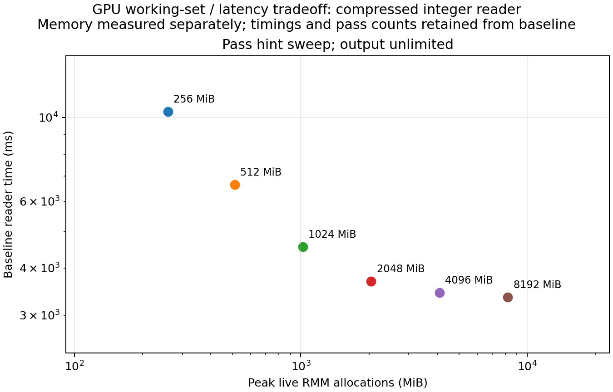

# GPU memory versus reader batching

All 12 measured reads matched the expected sum and row count. All ended with zero tracked live bytes and no device-query failures.

| Pass / output hint (MiB) | Input passes / subpasses | Baseline read (ms) | Peak live RMM (MiB) | Sampled device increase (MiB) |
|---|---:|---:|---:|---:|
| 256 / 0 | 96 / 288 | 10364.20 | 259.17 | 266.00 |
| 512 / 0 | 48 / 144 | 6646.10 | 510.78 | 514.00 |
| 1024 / 0 | 22 / 64 | 4553.30 | 1020.29 | 1024.00 |
| 2048 / 0 | 11 / 31 | 3690.11 | 2044.34 | 2048.00 |
| 4096 / 0 | 5 / 15 | 3437.42 | 4096.17 | 4102.00 |
| 8192 / 0 | 3 / 8 | 3347.94 | 8189.96 | 8194.00 |

Zero disables a hint. Timings and trace counts are from the original separate runs.
Peak RMM bytes are live allocation requests routed through the current RMM resource, including reader temporaries, output columns and reduction scratch. The original default CUDA resource is wrapped, without adding a pool. Buffers are released between returned tables.
2 measured memory rounds per configuration, shuffled with seed 42, after one excluded warm-up per configuration.
Device usage is total minus free from cudaMemGetInfo, sampled on a separate thread with a requested 1 ms sleep. The observed peak is a lower bound: short-lived allocations may be missed. It includes the CUDA context, driver/library allocations and other GPU users; its increase is relative to each sample start.
Neither allocator accounting nor cudaMemGetInfo proves physical residency under WSL or measures process-exclusive VRAM. Async frees and future pool allocators can separate logical live bytes from physically reserved memory. These hints remain soft targets, not capacity guarantees.
Use peak live bytes to compare working sets, allow headroom for untracked allocations and concurrent workloads, and measure again if retaining output tables or changing allocator/workload.

[Raw memory samples](memory-samples.csv) · [Joined summary](memory-summary.csv) · [Capture setup](memory-capture.json)
