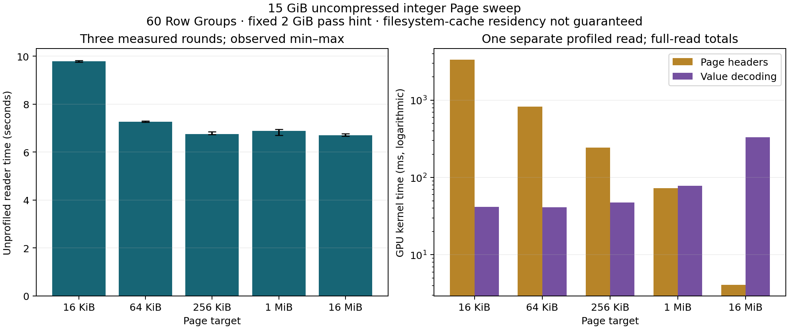

# 15 GiB uncompressed Page-size sweep

2,013,265,920 rows, 60 Row Groups, one INT64 column. Expected sum: 10,065,327,315,400.
All 15 baseline and five separately profiled reads passed row, column and sum checks. No dictionary, statistics, compression, predicates or GDS.
Three baseline rounds and one separate trace after an excluded warm-up per layout. The fixed pass hint is 2 GiB; output hint disabled.
Each file exceeds available host RAM. No warm-cache guarantee or cache flushing; file I/O remains part of the read.

| Page target | Actual data Pages | Pages / chunk | Reader median (s) | Reader min–max (s) | Input passes / subpasses | Header kernels (ms) | Value decoding (ms) | Decoder grids | Reader kernels |
|---|---:|---:|---:|---:|---:|---:|---:|---|---:|
| 16 KiB | 983,040 | 16384 | 9.792 | 9.757–9.824 | 30 / 30 | 3319.630 | 41.416 | 32768 | 1230 |
| 64 KiB | 245,760 | 4096 | 7.258 | 7.241–7.292 | 30 / 30 | 827.632 | 40.970 | 8192 | 1230 |
| 256 KiB | 61,440 | 1024 | 6.746 | 6.735–6.855 | 30 / 30 | 244.385 | 47.402 | 2048 | 1020 |
| 1 MiB | 15,360 | 256 | 6.883 | 6.693–6.944 | 30 / 30 | 72.530 | 78.121 | 512 | 1020 |
| 16 MiB | 960 | 16 | 6.694 | 6.660–6.769 | 30 / 30 | 4.101 | 329.151 | 32 | 1020 |

Reader time sums synchronized constructor, has_next and read_chunk calls; reduction is separate. Every returned table is released after its sum.
GPU timing columns describe one profiled read per layout, not repeated profiled medians. They include only has_next/read_chunk phases and exclude reductions. Kernel busy time is event-interval union, not SM utilization.
Timeline CSVs contain an exact first-output-batch excerpt; trace-summary.csv contains totals for the full read. The article labels the different scopes.
The original 64 MiB study used four Row Groups and a whole-file read. This new study changes layout, API, and cache conditions along with scale; compare Page targets within a dataset.
[Method and commands](../LARGE_SCALE.md) · [Baseline summary](summary.csv) · [Trace summary](trace-summary.csv) · [Fixture](fixture.json)
Full newly generated Nsight/SQLite captures remain local under experiments/traces/large-page*. The small CSV summaries and exact first-batch excerpts are versioned; the large captures follow the repository ignore policy.
